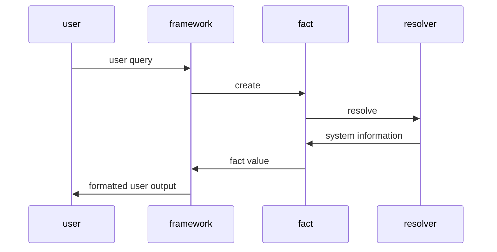

# openfact

OpenFact is a community implementation of [Facter](https://github.com/puppetlabs/facter/), a command-line tool that gathers basic facts about nodes (systems)
such as hardware details, network settings, OS type and version, and more.
These facts are made available as variables in your Puppet manifests and can be
used to inform conditional expressions in Puppet.

## Documentation

Documentation for OpenFact can be found on the [OpenVox Docs
site](https://docs.openvoxproject.org/openfact/latest/).

Your help improving the documentation is very welcome!
Reach out to the [Documentation Special Interest Group](https://github.com/voxpupuli/community-triage/wiki/SIG.Documentation) if you want to help.

## Supported platforms
* Linux
* macOS
* Windows
* Solaris
* AIX

## Requirements
* Ruby 2.5+
* FFI (for facts like `mountpoints` which are resolved using C API calls)

## Basic concepts
The project has three main parts, the framework, facts and resolvers.
In the framework we implement functionality that is agnostic of specific facts like parsing user input, formatting output, etc.

Facts are the nuggets of information that will be provided by openfact e.g. `os.name`, `networking.interfaces`, etc.

Resolvers have the role of gathering data from the system.
For example a resolver can execute a command on the system, can read a file or any operation that retrieves some data from a single source on the system.

## Getting started
After cloning the project, run `bundle install` to install all dependencies.

You can run openfact by executing `./bin/facter`.
The command will output all the facts that openfact detected for the current OS.

The implementation can be validated locally by running `bundle exec rake check`.

## Licensing
See [LICENSE](LICENSE) file.
OpenFact is licensed by the OpenVox Project as a community maintained implementation of Facter.
The OpenVox Project can be contacted at: openvox@voxpupuli.org.
Puppet itself is licensed by Puppet, Inc. under the Apache license.
Puppet, Inc. can be contacted at: info@puppet.com.

## Making a release

We currently maintain different branches in openfact.
The openfact main branch is always used in the main branch of openvox.
Currently this is OpenFact 6.x with OpenVox 9.x.
The OpenFact 5.x branch is used by OpenVox 8.x.
When you want to make a new release:
* Review open PRs
* Run the [prepare release](https://github.com/OpenVoxProject/openfact/actions/workflows/prepare_release.yml) workflow, we always try to release the main branch first.
* Apply labels to issues/PRs in the changelog, rerun the workflow if the provided version number isn't correct.
* Before releasing any branch that isn't main, diff that branch with main and check for code that should be backported.
* If you find something, go to the related PR and add the `backport 8.x` label to backport it to 8.x.
* After a release PR is merged, run the [release](https://github.com/OpenVoxProject/openfact/actions/workflows/release.yml) workflow
* The workflow will create a GitHub release and publish to rubygems
* until https://github.com/OpenVoxProject/openfact/pull/239 is merged, promote new openfact releases to [openvox](https://github.com/OpenVoxProject/openvox/actions/workflows/promote.yml) & [puppet-runtime](https://github.com/OpenVoxProject/puppet-runtime/blob/main/configs/components/rubygem-openfact.rb)
* If successful, another PR will be opened. If an automatic backport won't work due to git conflicts, a comment with instructions will be added to the PR.
